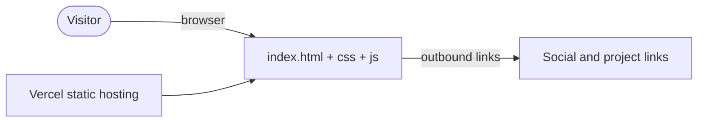

# LinkHub: High-Level Design

A customizable "all your links on one page" site (link-in-bio), with a profile header, tabbed sections of links and theme settings in CSS variables. Live at [link-hub-cyan.vercel.app](https://link-hub-cyan.vercel.app). For code-level detail see the [Low-Level Design](lld.md).

## 1. Context

## 2. Components

| Component | Responsibility |
|---|---|
| Profile header | Photo, name and description |
| Tab menu | Three menu items switch between three link sections |
| Link sections | Lists of links with SVG icons |
| Theme | CSS custom properties for fonts, colors, background image, image size and menu colors |

## 3. Tech

| Item | Choice |
|---|---|
| Stack | HTML, CSS (`reset.css`, `style.css`), vanilla JavaScript (`js/main.js`) |
| Customization | Edit CSS variables and HTML; settings documented in the repo wiki |
| Hosting | Vercel |
