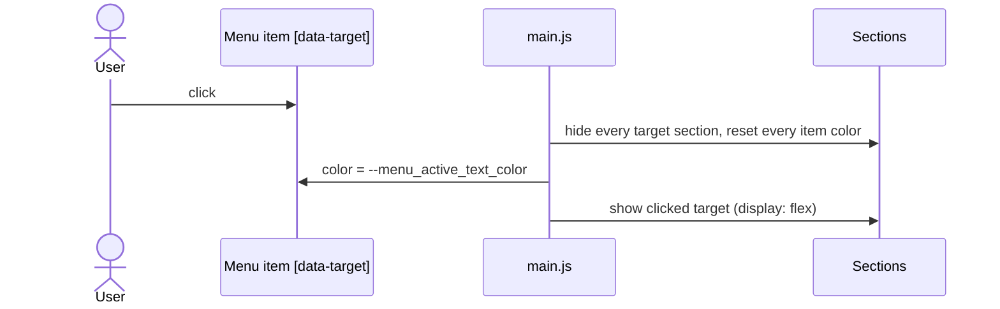

# LinkHub: Low-Level Design

For the big picture see the [High-Level Design](hld.md).

## 1. Tab switching (`js/main.js`)

| Menu item | Shows |
|---|---|
| `#header_nav_menu_item_1` → `data-target="#main_section_container_1"` | Section 1 |
| `#header_nav_menu_item_2` → `#main_section_container_2` | Section 2 |
| `#header_nav_menu_item_3` → `#main_section_container_3` | Section 3 |

## 2. Theme variables (`css/style.css`)

| Variable | Default | Controls |
|---|---|---|
| `--font_family`, `--font_size` | Inter, 16px | Typography |
| `--background_color`, `--background_image` | `#000`, `img/wallpaper.jpg` | Page background |
| `--image_width`, `--image_height`, `--image_border_color`, `--image_border_px` | 140px, 140px, `#000`, 3px | Profile photo |
| `--title_color`, `--description_color` | `#fff`, `#f1c40f` | Header text |
| `--svg_color` | `#fff` | Icon color |
| `--menu_background_color`, `--menu_text_color`, `--menu_active_text_color` | | Tab menu |

## 3. Customizing

Replace the photo and wallpaper in `img/`, edit links in `index.html`, and change the variables above. No build step.
